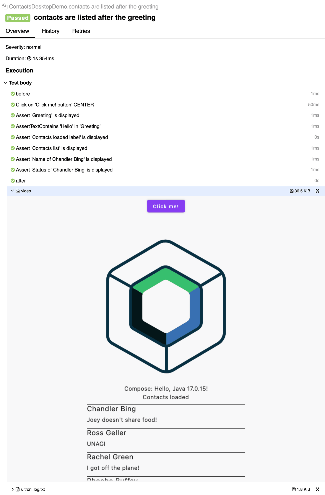
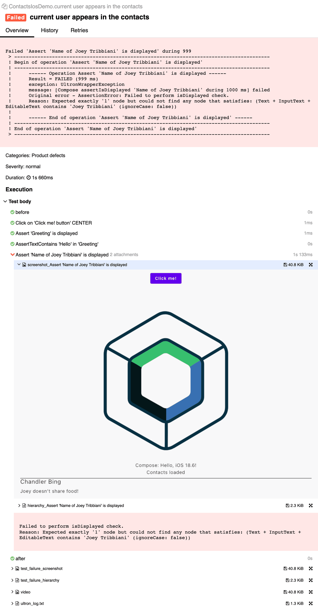
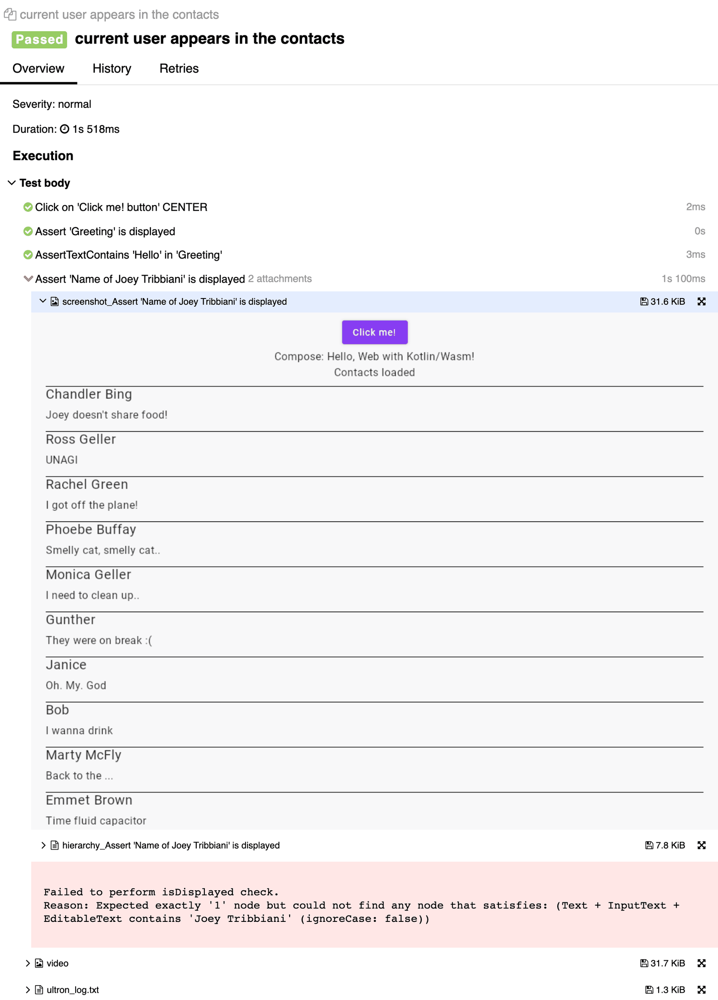
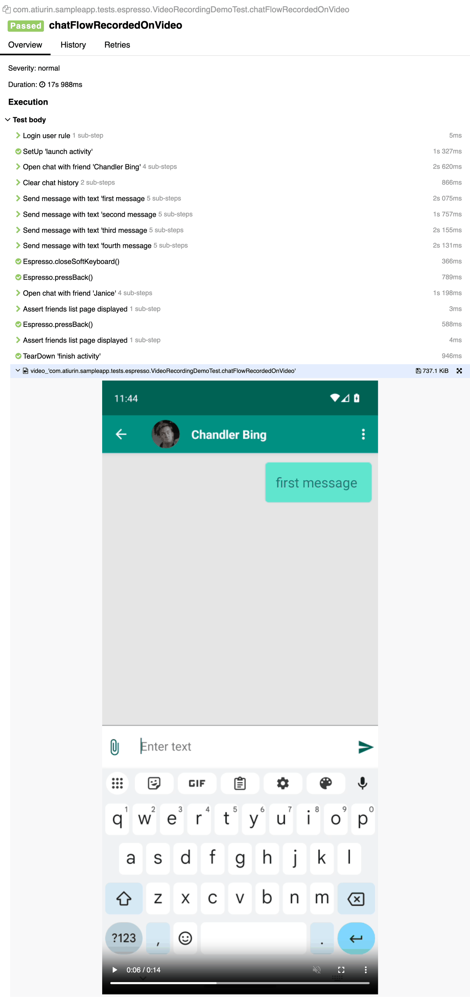

import Tabs from '@theme/Tabs';
import TabItem from '@theme/TabItem';

# Allure for Compose Multiplatform

`ultron-allure` reports Ultron operations as steps, attaches screenshots and semantics trees on failure, and includes the test log. Video is optional. It supports desktop, iOS, macOS, JS and Wasm. Android instrumented tests use the [Android setup](./allure.md).

:::tip New in 2.7.0
**Allure for Compose Multiplatform is available since Ultron 2.7.0.** Use `ultron-compose` and `ultron-allure` 2.7.0 or later; earlier versions report Android instrumented tests only. Inside the Ultron repository itself, depend on `project(":ultron-allure")`.
:::

## Supported targets

| Target | Reporting | Results land in | `host` label |
|---|---|---|---|
| Desktop (JVM) | Enabled by default | A directory on disk, see [Results directory](#results-directory) | `desktop` |
| iOS simulator | Enabled by default | A directory on disk, forwarded to the host with `SIMCTL_CHILD_ULTRON_ALLURE_RESULTS_DIR` | `ios` |
| macOS | Enabled by default | A directory on disk | `macosx` |
| js, wasmJs (browser via Karma; under Node.js only the result writer, without Compose UI) | Enabled by default, **in memory**: no file is ever written, results are dumped to the console and collected on the host | `UltronAllureResults` in the page | `web` |
| Android | Reported through the `allure-kotlin` pipeline of the same module, see [Allure (Android)](./allure.md) | `<app files dir>/allure-results` on the device, pulled with `adb` | the host name `allure-kotlin` reads on the device |

Every target that renders through Skiko (desktop, iOS, macOS, js, wasmJs) supports all features of the module, including screenshots and the video. Tests on a physical iOS device are not covered by this page: there is no recipe yet to bring their results to the host. The `host` label is what the report shows under *Host* in the test overview, and it is the quickest way to tell which platform a result came from when several platforms write into one results directory. It does not keep the results of the same test apart: the `target` parameter and the `historyId` do, see [Labels](./allure-multiplatform-reference.md#labels).

## Quick start

Start with a module that already runs Compose Multiplatform UI tests. For a module that also targets Android, use the [shared configuration recipe](#what-common-test-code-can-see).

### Add the dependency

```kotlin
// build.gradle.kts
kotlin {
    sourceSets {
        commonTest.dependencies {
            implementation("com.atiurin:ultron-compose:2.7.0") // 2.7.0 or later
            implementation("com.atiurin:ultron-allure:2.7.0")
        }
    }
}
```

### Configure reporting and write a test

```kotlin
// commonTest/kotlin/LoginTest.kt
import androidx.compose.ui.test.ExperimentalTestApi
import androidx.compose.ui.test.hasTestTag
import com.atiurin.ultron.allure.config.UltronAllureConfig
import com.atiurin.ultron.annotations.ExperimentalUltronApi
import com.atiurin.ultron.core.compose.runUltronUiTest
import com.atiurin.ultron.core.test.UltronTest
import com.atiurin.ultron.extensions.assertIsDisplayed
import kotlin.test.Test

@OptIn(ExperimentalTestApi::class, ExperimentalUltronApi::class)
class LoginTest : UltronTest() {
    // Runs once, before the first test of the class.
    override val beforeFirstTest = { UltronAllureConfig.applyRecommended() }

    @Test
    fun loginIsVisible() = test(name = "login is visible") {
        go {
            runUltronUiTest {
                setContent { App() } // Your application composable.
                hasTestTag("login").assertIsDisplayed()
            }
        }
    }
}
```

Write the test function with `=` so it returns `test { }`: on JS/Wasm that is a promise the runner awaits, and `test { }` waits for the `runUltronUiTest` inside it. The same code runs on every target. `test(name = ...)` names the result and groups it under the class in the report. [Write tests with `UltronTest`](#write-tests-with-ultrontest) adds `before { }` and `after { }`; [Without `UltronTest`](#without-ultrontest) shows the plain `runUltronUiTest` form.

### Open the first desktop report

```kotlin
// build.gradle.kts
tasks.named<Test>("desktopTest") {
    val results = layout.buildDirectory.dir("allure-results/desktop")
    environment("ULTRON_ALLURE_RESULTS_DIR", results.get().asFile.absolutePath)
    outputs.dir(results)
}
```

```bash
brew install allure
./gradlew :app:desktopTest
allure generate app/build/allure-results/desktop --clean -o build/allure-report
allure open build/allure-report
```

Replace `app` with your module name. For [iOS](#ios-simulator), [macOS](#macos), [browsers](#browsers-js--wasmjs) and [Android](#android), use the result collection recipes in [From results to a report](#from-results-to-a-report).

## The report on each target

The same scenario, written once against the `composeApp` demo app (`ContactsScreen` in `composeApp/src/commonTest`), as Allure shows it on every platform. Element names come from `withName(...)`, which is why the step titles read the same everywhere.

<Tabs groupId="platform">
<TabItem value="desktop" label="Desktop" default>

An `UltronTest` on the JVM: `before` and `after` are steps, the class is the suite, and the `video` attachment is the frame-by-frame video of the whole test, opened inline: an H.264 `video/mp4` by default (an animated PNG with `videoFormat = APNG`, or when the encoder fails). The scene is the 480×800 surface given to `runDesktopUltronUiTest`.



</TabItem>
<TabItem value="ios" label="iOS">

The same `UltronTest` on the iOS simulator, in its failing variant. The failed operation carries its own `screenshot_…` and `hierarchy_…` attachments, the test carries `test_failure_screenshot`, `test_failure_hierarchy`, the `video` and the Ultron log; the message of the failed operation is at the top. Results reached the host through `SIMCTL_CHILD_ULTRON_ALLURE_RESULTS_DIR` (see [iOS simulator](#ios-simulator)).



</TabItem>
<TabItem value="wasm" label="wasmJs">

The browser target, here in the plain form named with `runUltronUiTest("…")` (an `UltronTest` looks as on desktop): the failing operation is caught inside the test body, so the test is `passed` while the step is `failed` and still carries the screenshot and the semantics tree. The result never touched a file system: it was collected from the Karma console by the Gradle task described in [Browsers](#browsers-js--wasmjs).



</TabItem>
<TabItem value="android" label="Android">

Android instrumented tests go through the `allure-kotlin` pipeline of the same module (see [Allure (Android)](./allure.md)): Espresso steps with sub-steps, and the mp4 recorded by `screenrecord` plays inline.



</TabItem>
</Tabs>

## Write tests

### Write tests with `UltronTest`

The recommended way is to write tests as subclasses of [`UltronTest`](./ultrontest.md): its lifecycle is what the Allure module follows, and it gives you everything in one place, on every target:

- `beforeFirstTest` runs once per class and is where `UltronAllureConfig` is applied; no extra object, runner or JUnit rule is needed.
- `test(name = "...")` opens the Allure test and names it. The name works on every platform, including iOS and macOS where nothing can be discovered from the stack, and it groups the result under the class in the *Suites* tree.
- Every result has steps named `before` and `after`, one for each block, empty when the block is not set; `go { }` holds the `runUltronUiTest` block, whose Ultron operations are the top-level steps.
- The result is written when `test { }` finishes (in the browser: when the promise it returns settles), so a failure anywhere, including in `after { }`, fails the test.

:::caution Browsers
Write the test function with `=`, `fun login() = test { ... }`, as in the examples. A block body, `fun login() { test { ... } }`, drops the promise that `test { }` returns on js/wasmJs, and the browser runner moves on before the UI code has run. Call `runUltronUiTest` once per block.
:::

```kotlin
// commonTest/kotlin/LoginTest.kt
import androidx.compose.ui.test.ExperimentalTestApi
import androidx.compose.ui.test.hasTestTag
import com.atiurin.ultron.annotations.ExperimentalUltronApi
import com.atiurin.ultron.core.compose.runUltronUiTest
import com.atiurin.ultron.core.test.UltronTest
import com.atiurin.ultron.extensions.assertIsDisplayed
import com.atiurin.ultron.extensions.click
import kotlin.test.Test

@OptIn(ExperimentalTestApi::class, ExperimentalUltronApi::class)
class LoginTest : UltronTest() {
    // configureAllure() is the expect/actual from "What common test code can see". In a module without an
    // Android target the body can be written here directly:
    //   UltronAllureConfig.apply { videoPolicy = mutableSetOf(AllureAttachStrategy.TEST_FAILURE) }
    override val beforeFirstTest = { configureAllure() }

    // before { } and after { } are optional; test(name) { go { ... } } is enough. The report has a "before" and an
    // "after" step either way, empty when the block is not set. FakeAuthServer stands for your own test fixture.
    @Test
    fun loginShowsError() = test(name = "login with wrong password shows an error") {
        before {
            // optional: prepare the test data, e.g. a fake backend that rejects the login
            FakeAuthServer.rejectEveryLogin()
        }.go {
            runUltronUiTest {
                setContent { App() }
                hasTestTag("login").click()
                hasTestTag("error").assertIsDisplayed()
            }
        }.after {
            // optional: clean up
            FakeAuthServer.reset()
        }
    }
}
```

For a parameterized test keep one name and add the values as parameters with `UltronAllure.parameter("user", user)` inside the block (Skiko targets only: it does not compile in the `commonTest` of a module with an Android target), so its invocations are reported apart under one test case; see [Labels](./allure-multiplatform-reference.md#labels). For naming and lifecycle rules, see [UltronTest lifecycle](./allure-multiplatform-reference.md#ultrontest-lifecycle) in the reference.


### Without `UltronTest`

Plain `runUltronUiTest` tests are reported too. Use this form when there is a reason not to subclass `UltronTest`: an existing suite of plain `runUltronUiTest` tests you do not want to rewrite, or tests that live in a class hierarchy of their own. It works on every target as well; on js/wasmJs return `runUltronUiTest` from the test function, as below.

Two things then have to be done by hand. First, `UltronAllureConfig` must be applied once per test process **before** the first `runUltronUiTest`. `kotlin.test` has no `@BeforeClass` on every target, so the portable "run once" is an `object` whose initialiser applies the config, touched from each test class. The configuration itself is the `configureAllure()` of [What common test code can see](#what-common-test-code-can-see) (in a module without an Android target, `UltronAllureConfig.apply { videoPolicy = ... }` can stand in the `init` directly):

```kotlin
// commonTest/kotlin/AllureTestSetup.kt
object AllureTestSetup {
    init {
        configureAllure()
    }

    fun ensure() = Unit
}
```

Second, the test boundary is the `runUltronUiTest` block itself, so the name has to be passed to it; otherwise it is discovered on the JVM only (see [Test names and boundaries](./allure-multiplatform-reference.md#test-names-and-boundaries)):

```kotlin
// commonTest/kotlin/LoginTest.kt
@OptIn(ExperimentalTestApi::class)
class LoginTest {
    @BeforeTest
    fun allure() = AllureTestSetup.ensure()

    @Test
    fun loginShowsError() = runUltronUiTest("login shows error") {
        setContent { App() }
        hasTestTag("login").click()
        hasTestTag("error").assertIsDisplayed()
    }
}
```

There is still no instrumentation runner to set and no JUnit rule to add, and the steps are the Ultron operations executed inside the block. What you lose compared to `UltronTest` is the class grouping on Native and in the browser without the [name adapter](./allure-multiplatform-reference.md#test-names-in-the-browser), the `before`/`after` steps and the common `beforeTest`/`afterTest` hooks.

:::tip
Use the sample project as a reference: the `UltronTest` samples [`AllureUltronTestDesktopTest.kt`](https://github.com/open-tool/ultron/blob/master/composeApp/src/desktopTest/kotlin/AllureUltronTestDesktopTest.kt) and [`AllureResultsIosTest.kt`](https://github.com/open-tool/ultron/blob/master/composeApp/src/iosTest/kotlin/AllureResultsIosTest.kt), the plain-form setup [`AllureTestSetup.kt`](https://github.com/open-tool/ultron/blob/master/composeApp/src/commonTest/kotlin/AllureTestSetup.kt) with [`AllureResultsDesktopTest.kt`](https://github.com/open-tool/ultron/blob/master/composeApp/src/desktopTest/kotlin/AllureResultsDesktopTest.kt), and the browser test [`AllureResultsWasmTest.kt`](https://github.com/open-tool/ultron/blob/master/composeApp/src/wasmJsTest/kotlin/AllureResultsWasmTest.kt).
:::

## Modules with an Android target

### What common test code can see

`UltronAllureConfig` is one `expect` object with an `actual` for Android and one for the Skiko targets (desktop, iOS, macOS, js, wasmJs). Only `params`, `applyRecommended()`, `apply { }` and the parameters `addScreenshotPolicy`, `addHierarchyPolicy`, `attachUltronLog` and `detailedAllureReport` are common; everything else, video and the results directory included, exists on one side only (see the [side-by-side table](./allure-multiplatform-reference.md#android-and-compose-multiplatform-side-by-side)).

Which of them `commonTest` compiles against depends on the targets of **your** module, because Kotlin resolves a library's source sets against the consumer's target set:

- **No Android target** (desktop, iOS, macOS, js, wasmJs in any combination): every target of the module is a Skiko one, so `commonTest` sees the Skiko `actual` with `videoPolicy`, `resultsDirectory` and `UltronAllure`, and the examples on this page compile as written.
- **An Android target as well**: `commonTest` sees only the four common parameters; `videoPolicy` and the other Skiko-only members do not compile there. And at runtime the Android `applyRecommended()` / `apply { }` registers run listeners through the instrumentation, which requires `UltronAllureTestRunner`: called from a plain Android unit test, or from an instrumented test without that runner, it throws. So the configuration goes into a platform-specific `actual`, shared by the Skiko targets through an intermediate source set, with a no-op (or an Android-specific) `actual` for Android:

```kotlin
// build.gradle.kts: one test source set for every Skiko target, one for Android
kotlin {
    applyDefaultHierarchyTemplate {
        common {
            group("skiko") { withJvm(); withNative(); withJs(); withWasmJs() } // skikoMain / skikoTest
            group("androidShared") { withAndroidTarget() }                    // androidSharedTest: unit + instrumented
        }
    }
    // targets as usual
}
```

```kotlin
// commonTest/kotlin/AllureSetup.kt
internal expect fun configureAllure()

// skikoTest/kotlin/AllureSetup.skiko.kt
import com.atiurin.ultron.allure.config.AllureAttachStrategy
import com.atiurin.ultron.allure.config.UltronAllureConfig

internal actual fun configureAllure() {
    UltronAllureConfig.apply {
        videoPolicy = mutableSetOf(AllureAttachStrategy.TEST_FAILURE) // Skiko-only members are visible here
    }
}

// androidSharedTest/kotlin/AllureSetup.android.kt
// Android instrumented tests configure Allure in @BeforeClass with UltronAllureTestRunner (see the Android page);
// nothing to do from the shared setup, which Android unit tests reach as well.
internal actual fun configureAllure() = Unit
```

Code that calls `UltronAllure.captureVideoFrame(...)` or `UltronAllure.lifecycle.attach(...)` belongs in the same `skikoTest` source set, or behind an `expect` of your own, for the same reason. The `composeApp` sample is laid out like this ([`build.gradle.kts`](https://github.com/open-tool/ultron/blob/master/composeApp/build.gradle.kts), [`AllureTestSetup.kt`](https://github.com/open-tool/ultron/blob/master/composeApp/src/commonTest/kotlin/AllureTestSetup.kt) with its [Skiko](https://github.com/open-tool/ultron/blob/master/composeApp/src/skikoTest/kotlin/AllureTestSetup.skiko.kt) and [Android](https://github.com/open-tool/ultron/blob/master/composeApp/src/androidSharedTest/kotlin/AllureTestSetup.android.kt) actuals).


## From results to a report

Ultron writes Allure 2 **result files** (`<uuid>-result.json` plus `<uuid>-attachment.<ext>`); the HTML report is built from them on the host by the Allure command line, after the test task has finished. This section is the end-to-end recipe for a project of your own. `app` below stands for the Gradle module that holds your Compose Multiplatform tests; replace it with yours.

In short:

1. [Install the Allure command line](#install-the-allure-command-line) once.
2. Make sure each target you run puts its results on the host: [desktop](#results-directory) and [macOS](#macos) write to the host directly (give each its own directory on the test task), [iOS](#ios-simulator) needs one environment variable on the test task, [browsers](#browsers-js--wasmjs) need a Karma option and a small Gradle task, [Android](#android) needs `adb pull`.
3. Run the tests, then [generate the report](#generate-the-report) from the results directories, one platform or all of them at once.

### Install the Allure command line

Follow the [Allure Report install guide](https://allurereport.org/docs/install/), or:

```bash
brew install allure                               # macOS
# or, without installing anything: npx allure-commandline@2.32.0 <command>
```

### Results directory

On desktop, iOS and macOS the results directory is resolved in this order and logged as `Allure results go to <path>` when the first test after an `applyRecommended()` / `apply { }` starts (once per configuration, so once per process in the usual setup):

1. `UltronAllureConfig.params.resultsDirectory`
2. the `ULTRON_ALLURE_RESULTS_DIR` environment variable
3. `build/allure-results` relative to the working directory of the test process

The directory is **never cleaned** by Ultron: results of previous runs stay there until you delete them, so clean it before a run whose report must contain only that run (or point every run at a fresh directory). Browsers have no file system; their results are collected into a directory of your choice by the task shown below, which empties it on every run.

After the setup of this section, this is where the results of each target are on the host:

| Target | Results on the host | How they get there |
|---|---|---|
| Desktop (JVM) | the directory in `ULTRON_ALLURE_RESULTS_DIR`, e.g. `app/build/allure-results/desktop`; `app/build/allure-results` when the variable is not set | Written directly by the test process |
| iOS simulator | the directory you put in `SIMCTL_CHILD_ULTRON_ALLURE_RESULTS_DIR`, e.g. `app/build/allure-results/ios` | Written by the simulator process; the simulator shares the host file system |
| macOS | the directory in `ULTRON_ALLURE_RESULTS_DIR`, e.g. `app/build/allure-results/macos`; `build/allure-results` relative to the test binary's working directory when the variable is not set | Written directly by the test process |
| js / wasmJs | the directory your collect task writes to, `app/build/allure-results/browser` (`js` and `wasm` with the two-target setup) | Printed to the browser console, stored by Karma in a log file, decoded into files by the collect task right after the browser test task |
| Android | wherever you `adb pull` them to, e.g. `build/allure-results-android` | `allure-kotlin` writes on the device, see [Allure (Android)](./allure.md#getting-the-report) |

### Desktop (JVM)

A desktop test task started by Gradle writes to `app/build/allure-results` by default. Give it a directory of its own and declare that directory as the task's output:

```kotlin
// app/build.gradle.kts
tasks.named<Test>("desktopTest") {
    val results = layout.buildDirectory.dir("allure-results/desktop")
    environment("ULTRON_ALLURE_RESULTS_DIR", results.get().asFile.absolutePath)
    outputs.dir(results) // the results are an output of the test task: a cached or up-to-date run restores them
}
```

Declare the directory as an output of the test task. Without it, a test task that Gradle considers `UP-TO-DATE`, or restores `FROM-CACHE` with `org.gradle.caching=true`, does not run the tests and therefore writes no results: a job that deletes the results directory first and then gets a cached test task ends with an empty report. With the output declared, Gradle restores the directory from the cache; to force a real run, pass `--rerun-tasks` (or `--rerun` on the test task).

Declare the target's own subdirectory, never the parent `build/allure-results`: the other targets write into subdirectories of it, and overlapping outputs break Gradle's caching. That parent is also the default location, which is why the variable is set even for a single-target module.

### iOS simulator

The test binary is started through `xcrun simctl spawn`, which forwards only environment variables prefixed with `SIMCTL_CHILD_`; a plain `environment("ULTRON_ALLURE_RESULTS_DIR", ...)` on the test task is invisible to the binary, and without the variable the results go to `build/allure-results` relative to the simulator process's working directory, which is not where you expect. Set it on the simulator test tasks:

```kotlin
// app/build.gradle.kts
tasks.withType<org.jetbrains.kotlin.gradle.targets.native.tasks.KotlinNativeSimulatorTest>().configureEach {
    val results = layout.buildDirectory.dir("allure-results/ios")
    environment("SIMCTL_CHILD_ULTRON_ALLURE_RESULTS_DIR", results.get().asFile.absolutePath)
    outputs.dir(results) // same reason as on desktop: a cached or up-to-date test task writes nothing
}
```

The simulator shares the host file system, so the directory is a normal host path and `allure generate app/build/allure-results/ios` works directly.

### macOS

macOS test binaries run directly on the host, so the variable needs no prefix. The `macosArm64Test` / `macosX64Test` tasks are Kotlin/Native host test tasks, not `Test`, so configure them by their own type:

```kotlin
// app/build.gradle.kts
tasks.withType<org.jetbrains.kotlin.gradle.targets.native.tasks.KotlinNativeHostTest>().configureEach {
    val results = layout.buildDirectory.dir("allure-results/macos")
    environment("ULTRON_ALLURE_RESULTS_DIR", results.get().asFile.absolutePath)
    outputs.dir(results) // same reason as on desktop: a cached or up-to-date test task writes nothing
}
```

### Browsers (js / wasmJs)

A browser has no file system, so on `js` and `wasmJs` the module keeps every result and attachment in memory in `UltronAllureResults` and never attempts a file write. The transport to the host is the browser console: **every file is printed the moment it is written**, as one `ULTRON_ALLURE_RESULT <fileName> <base64>` line. Karma can write the browser console to a file, and a small Gradle task decodes the lines back into files. Because the lines are streamed and not collected at the end of the run, a page that crashes mid-run (a wasm trap, an out-of-memory tab, a Karma disconnect) preserves files already printed. When video encoding is still pending, the test result may not have been printed yet; see [browser video](./allure-multiplatform-reference.md#limits-and-caveats).

Two pieces go into your module, both copy-and-paste.

**1. Karma writes the console to a file.** Kotlin concatenates every `*.js` in `app/karma.config.d/` (sorted by name, not recursive) into the body of one function in the generated `karma.conf.js`, so all fragments share one scope: wrap each fragment in a function of its own, otherwise a second `const path` in another fragment is a `SyntaxError`. Karma's `basePath` is `<root project>/build/js/packages/<root project name>-<module>-test` (`build/wasm/...` for wasmJs), so four `..` from it is the root project directory, and the log goes to `<root project>/build/karma-console.log`. The last statement raises mocha's per-test timeout from its 2 s default, which a test with many operations or a video exceeds:

```js
// app/karma.config.d/ultron-allure.js
(function () {
    const path = require("path");
    const rootProject = path.resolve(config.basePath, "..", "..", "..", "..");

    config.browserConsoleLogOptions = {
        level: "debug",
        terminal: false, // keep the multi-megabyte base64 lines out of Gradle's stdout
        path: path.resolve(rootProject, "build", "karma-console.log"),
    };
    config.client = config.client || {};
    config.client.mocha = Object.assign({}, config.client.mocha, {timeout: 60000});
})();
```

**2. A Gradle task turns the log into a results directory** and runs right after the browser test task. Karma appends to the log, so the test task deletes it first; the collect task starts from an empty directory, so a run never shows the results of an earlier one. Files are written by name, which also makes a repeated line (see [`dumpToConsole()`](./allure-multiplatform-reference.md#browser-results-in-detail)) harmless:

```kotlin
// app/build.gradle.kts
import java.util.Base64 // at the top of the script: inside it, `java` is the Java plugin extension, not the package

val collectBrowserAllureResults = tasks.register("collectBrowserAllureResults") {
    // Locals, not script-level vals: a doLast { } that captures a top-level val of the build script captures
    // the whole script object, which the configuration cache cannot serialize.
    val karmaLog = rootProject.layout.buildDirectory.file("karma-console.log") // the path from the Karma fragment
    val out = layout.buildDirectory.dir("allure-results/browser")
    inputs.files(karmaLog).optional()
    outputs.dir(out)
    doLast {
        val source = karmaLog.get().asFile
        val targetDir = out.get().asFile.apply { deleteRecursively(); mkdirs() }
        if (!source.isFile) { logger.lifecycle("No Karma console log at $source, nothing to collect"); return@doLast }
        val line = Regex("ULTRON_ALLURE_RESULT (\\S+) ([A-Za-z0-9+/=]+)")
        var written = 0
        source.forEachLine { l ->
            line.find(l)?.let { m ->
                targetDir.resolve(m.groupValues[1]).writeBytes(Base64.getDecoder().decode(m.groupValues[2]))
                written++
            }
        }
        logger.lifecycle("Collected $written Allure result files from the browser into $targetDir")
    }
}
tasks.matching { it.name == "jsBrowserTest" || it.name == "wasmJsBrowserTest" }.configureEach {
    val karmaLog = rootProject.layout.buildDirectory.file("karma-console.log")
    doFirst { karmaLog.get().asFile.delete() }
    finalizedBy(collectBrowserAllureResults)
}
```

The snippet works with `org.gradle.configuration-cache=true`; the collect task declares the results directory as its output, so a second invocation without a new log is `UP-TO-DATE` and leaves the directory as it is.

That is enough for a module with one browser target, or for running `jsBrowserTest` and `wasmJsBrowserTest` in separate Gradle invocations. A module that runs **both** targets in one invocation needs a log and a collect task per target, otherwise the second run overwrites the first: give each target its own Karma directory with `useConfigDirectory` and its own log name, and register the task in a loop ([the sample project does exactly this](https://github.com/open-tool/ultron/blob/master/composeApp/build.gradle.kts)):

```kotlin
// app/build.gradle.kts
kotlin {
    js(IR) { browser { testTask { useKarma { useChromeHeadless(); useConfigDirectory(projectDir.resolve("karma.config.d/js")) } } } }
    wasmJs { browser { testTask { useKarma { useChromeHeadless(); useConfigDirectory(projectDir.resolve("karma.config.d/wasm")) } } } }
}
listOf("js" to "jsBrowserTest", "wasm" to "wasmJsBrowserTest").forEach { (target, browserTestTask) ->
    val log = rootProject.layout.buildDirectory.file("karma-console-$target.log") // karma.config.d/<target>/*.js writes here
    val collect = tasks.register("collect${target.replaceFirstChar { it.uppercase() }}AllureResults") {
        // the body of collectBrowserAllureResults above, with `log` and layout.buildDirectory.dir("allure-results/$target")
    }
    tasks.matching { it.name == browserTestTask }.configureEach {
        doFirst { log.get().asFile.delete() }
        finalizedBy(collect)
    }
}
```

The tests themselves need nothing: every result file and attachment is printed as it is written, and `test { }` (or a plain `runUltronUiTest`) settles its promise only once its result is in the console. The in-memory store, its accessors for other transports, memory limits and test-name discovery in the browser are described in [Browser results in detail](./allure-multiplatform-reference.md#browser-results-in-detail).

### Android

Android instrumented tests report through the `allure-kotlin` pipeline of the same module and write on the device; redirect the results to the download directory with `setAllureResultsDirectory(Environment.DIRECTORY_DOWNLOADS)` and `adb pull` them after the run, as described in [Getting the report](./allure.md#getting-the-report) on the Android page. The pulled directory is an ordinary Allure results directory and goes into the same `allure generate` as the others.

### Generate the report

Run the tests, then point `allure generate` at the results directory of the platform and open the report. Each target has its own directory (`allure-results/desktop`, `allure-results/ios`, `allure-results/macos`, `allure-results/browser` — or `allure-results/js` and `allure-results/wasm` with the [two-target browser setup](#browsers-js--wasmjs)), and Allure does not read subdirectories, so give it the target's directory, not the parent `allure-results`:

```bash
./gradlew :app:desktopTest
allure generate app/build/allure-results/desktop --clean -o build/allure-report
allure open build/allure-report

# iOS and the browsers: the same commands on their directories
./gradlew :app:iosSimulatorArm64Test
allure generate app/build/allure-results/ios --clean -o build/allure-report-ios

./gradlew :app:wasmJsBrowserTest        # the collect task runs automatically after it
allure generate app/build/allure-results/browser --clean -o build/allure-report-browser
```

`allure generate` accepts several directories, so one report can hold every platform of a run; the `host` label (`desktop`, `ios`, `macosx`, `web`, the device host name on Android) shows where a result came from, and the `target` parameter and `historyId` (see [Labels](./allure-multiplatform-reference.md#labels)) keep the same test of two targets apart, so neither is taken for a retry of the other:

```bash
./gradlew :app:desktopTest :app:iosSimulatorArm64Test :app:wasmJsBrowserTest
adb pull /sdcard/Download/allure-results build/allure-results-android   # after the Android run
allure generate \
    app/build/allure-results/desktop \
    app/build/allure-results/ios \
    app/build/allure-results/browser \
    build/allure-results-android \
    --clean -o build/allure-report
allure open build/allure-report
```

With the two-target browser setup pass `app/build/allure-results/js` and `app/build/allure-results/wasm` instead of `app/build/allure-results/browser`.

`allure serve <dirs>` does generate-and-open in one step into a temporary directory.

In CI, archive the results directories and the `history/` directory of the generated report. The report itself can be rebuilt from the results at any time. Trends across runs need that `history/`: copy the previous report's `history/` into a results directory before the next `allure generate`. Retries need nothing extra: results of the same test (same `historyId`) in one generation are grouped as retries. The commands on this page are for the Allure 2 command line; Allure 3 (`npx allure`) reads the same result files but has its own commands and history setup, see the [Allure Report documentation](https://allurereport.org/docs/). Remember that desktop, iOS and macOS directories are never cleaned by Ultron, so delete them at the start of the job, and that a test task Gradle skips as `UP-TO-DATE` or restores `FROM-CACHE` runs no test and writes no results: declare the directory as the task's output as shown above, or run with `--rerun-tasks`.

## Troubleshooting

| Symptom | Action |
|---|---|
| No files on desktop or Native | Check the configured results path and run with `--rerun-tasks`. |
| Empty browser report | Check the Karma console log path and collection task. Pending video encoding can delay result output. |
| Browser test fails in Karma but is `passed` in Allure | The error was raised after the test body had finished, for example a `MissingResourceException` from a Compose resource that Karma does not serve (a 404 for `/composeResources/...` in the log). Serve the `composeResources` directory of the test bundle from your Karma config, as the `composeApp` sample does. |
| `unknown test` | Name the test with `test(name = ...)` (or `runUltronUiTest("...")`); in the browser, unnamed tests are named by the [name adapter](./allure-multiplatform-reference.md#test-names-in-the-browser). |
| Missing screenshot | Use `runUltronUiTest` and capture while the Compose scene is alive. |
| Previous test reported as `broken` | Check for timeouts or overlapping test execution. Run tests sequentially. |
| Duplicate tests appear as retries | Check `fullName`, the `target` parameter and your own parameters (`UltronAllure.parameter`): results with the same `historyId` are grouped as retries. |

See the [configuration, lifecycle and video reference](./allure-multiplatform-reference.md) for detailed behavior.
